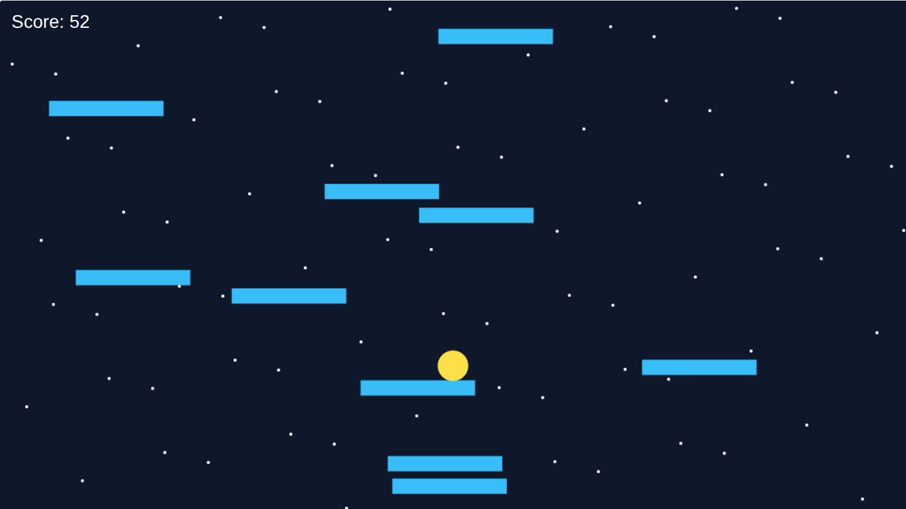

# noraugo470-wq.io
🌟 Cosmic Jumper
a simple game made to look like geometry dash but not geometry dash.
The aim is to just reach a high score and try not to fall
The Game is looking a bit basic right now but a lot of future updates will be added!
inspired my my love for science stuffs
.
🛑How to play🛑
1. open the Game link
2. Click the play button
3. ⚠ USING OR CLICKING SPACE DOESNT CURRENTLY WORK WILL BE ADDED IN FUTURE UPDATES⚠
4. After you clicked the space bar 
5. After loading in the aim of the game is to land on the BLUE platforms
6. the SCORE increases for every land on a platform
7. 
   🌸FUTURE UPDATES🌸
   - ability to move the BaLL left or right
   - difficulty levels
   - Game currency
   - Customisable Balls
   - obstacles
   - Challenges
     And more...

     this project is licensed under the [mit]
     
